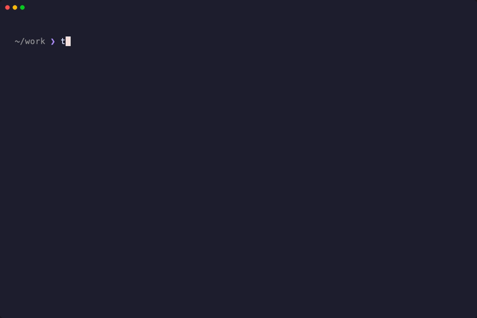
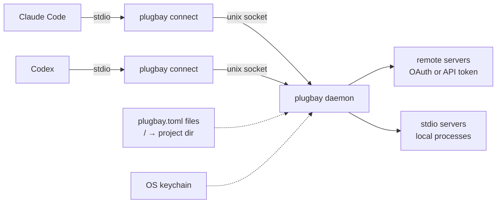

<p align="center">
  <picture>
    <source media="(prefers-color-scheme: dark)" srcset="docs/assets/logo-dark.svg">
    
  </picture>
</p>

<p align="center">
  <b>mise for MCP servers.</b><br>
  The right MCP servers, logged in to the right account, in every directory and every agent.
</p>

<p align="center">
  <a href="https://github.com/mihaicrisan04/plugbay/actions/workflows/ci.yml"></a>
  <a href="https://github.com/mihaicrisan04/plugbay/releases/latest"></a>
  <a href="LICENSE"></a>
  <a href="#install"></a>
</p>

<p align="center">
  
</p>

You work across clients. Each one has its own Sentry, its own PostHog, its own Linear workspace. Your agents don't know that: they get every MCP server you ever configured, logged in to whichever account you used last.

plugbay fixes that the way mise fixes tool versions. Small, committable `plugbay.toml` files say which MCP servers a directory tree needs, and which account of each. Every agent you start there gets exactly those, through one global MCP entry. Tokens stay in your keychain.

Works with Claude Code and Codex, and with T3 Code through them.

**Before:** the same servers configured again in `~/.claude.json`, `~/.codex/config.toml` and a `.mcp.json` per repo. Tokens pasted into JSON. One Sentry login for every client, and every server's tools loaded in every project.

**After:** two short files.

```toml
# ~/work/plugbay.toml: every repo under ~/work
[servers]
linear = "agency"

# ~/work/acme/plugbay.toml: every Acme repo
account = "acme"

[servers]
sentry = true      # sentry:acme
posthog = true     # posthog:acme
```

## How it works



- **One entry per agent.** `plugbay setup` registers `plugbay connect` once in Claude Code and Codex. You never edit their MCP config again.
- **Resolved per project.** The shim tells a per-user daemon where the agent started. The daemon walks from `/` down to that directory and merges every `plugbay.toml` on the way, deeper files winning, like mise.
- **Shared upstreams.** Each server + account connects once and is shared by every agent that needs it. Tools pass through as `server__tool`, and the server instructions tell the agent which account it is talking to.
- **Live.** Edit a file and the tools change in the running Claude Code session. An agent can switch a known server on for one session with `plugbay__enable`. The daemon starts on demand and exits when idle; there is no service to manage.

## Like mise, for MCP

| mise | plugbay |
| --- | --- |
| tools | MCP servers |
| versions (`node@22`) | accounts (`sentry:acme`) |
| `mise.toml` | `plugbay.toml` |
| `mise.local.toml` | `plugbay.local.toml` |
| `~/.config/mise/config.toml` | `~/.config/plugbay/config.toml` |
| `mise use node@22` | `plugbay use sentry:acme` |
| `mise ls` | `plugbay ls` |
| `mise trust` | `plugbay trust` |
| registry | registry (`linear`, `sentry`, `posthog`, `github`, `notion`, ...) |
| shims on `PATH` | one MCP entry per agent |

What's different:

- **Accounts are first-class.** One server, a different account per tree, in one line. Binding a server to two accounts in one place is an error unless you ask for both.
- **Credentials included.** plugbay logs you in (OAuth or API token) and keeps the result in the keychain, bound to the server's URL and the account.
- **Running agents follow along.** Config is resolved per agent session and re-resolved when a file changes, not once per command.

## Install

```sh
brew install mihaicrisan04/tap/plugbay
```

Or with Cargo (Rust 1.89+):

```sh
cargo install --locked --git https://github.com/mihaicrisan04/plugbay
```

Prebuilt binaries for macOS and Linux (arm64, x86_64) are on the [releases page](https://github.com/mihaicrisan04/plugbay/releases). To build from source: `git clone`, then `cargo build --release`.

## Quick start

Already have MCP servers in Claude Code or Codex? Move them over:

```sh
plugbay migrate            # prints the plan: catalog, pins, secrets to move
plugbay migrate --apply    # does it and registers plugbay; --undo rolls it back
```

Starting fresh:

```sh
plugbay setup                                  # register plugbay in Claude Code and Codex
cd ~/work/acme && plugbay use sentry:acme posthog:acme
plugbay login                                  # log in to every account that still needs it
```

Start an agent anywhere under `~/work/acme` and it gets `sentry__*` and `posthog__*` tools for Acme. `plugbay doctor` checks the whole setup.

## Configuration

Files load from the global config, then from `/` down to the project directory, `plugbay.toml` then `plugbay.local.toml` (personal; add it to your global gitignore) in each. Deeper wins, field by field.

```toml
# ~/work/plugbay.toml: every repo under ~/work
[servers]
linear = "agency"          # registry server, account "agency"
sentry = "agency"

# ~/work/acme/plugbay.toml: every repo for this client
account = "acme"           # default account for servers in this tree
[servers]
sentry = true              # sentry:acme
posthog = true             # posthog:acme
linear = false             # not for this client

# ~/work/acme/app/plugbay.toml
[servers]
posthog = { exclude_tools = ["delete_*"] }
```

| value | meaning |
| --- | --- |
| `"acme"` | on, with this account |
| `true` | on, with the tree's `account` (else `default`) |
| `false` | off, even if a parent turned it on |
| `["a", "b"]` | both accounts on purpose; tools become `name-a__*`, `name-b__*` |
| `{ ... }` | `account`, `url`, `headers`, `command`/`args`/`env`/`cwd`, `tools`/`exclude_tools`, `enabled` |

`root = true` at the top of a file stops inheritance from parent directories (the global config still applies).

**Your own servers** go into the catalog in the global config. A catalog entry is a definition that is off until a tree pins it:

```sh
plugbay add wiki --url https://mcp.wiki.example.com/mcp
plugbay add teams -- npx -y msteams-mcp
```

```toml
# ~/.config/plugbay/config.toml (written by `plugbay add`)
[servers.wiki]
url = "https://mcp.wiki.example.com/mcp"
enabled = false

# ~/work/acme/plugbay.toml
[servers]
wiki = true
```

**Accounts** can carry metadata the agent sees, their own endpoint, and a rule about who the login must be:

```toml
[accounts.posthog.acme]
region = "eu"
url = "https://mcp-eu.posthog.com/mcp"

[accounts.sentry.acme]
expect = "acme"            # off, with a clear message, if the login is another org
```

**Verified accounts:** for registry servers that can say who you are (Linear, GitHub, Sentry, ...), plugbay records the real workspace behind each login and shows it in `plugbay accounts` under `VERIFIED AS`, so a `personal` label can't quietly be your work workspace.

The full reference is [docs/config-schema.md](docs/config-schema.md).

## Commands

| `plugbay <command>` | what it does |
| --- | --- |
| `use <server[:account]>...` | Pin servers for this directory (`--local` for `plugbay.local.toml`, `-g` for global) |
| `unuse <server>...` | Remove a pin, or switch off a server this directory inherits |
| `ls` | The servers resolved here, and why any are missing (`--all`: every directory plugbay has seen) |
| `why <server>` | Which file set each field of a server |
| `accounts` | Every account in use: logged in or not, verified as whom, used where |
| `login [server[:account]]` | OAuth login, or `--token` / `--from-env VAR` for an API token. No argument: every missing login |
| `logout <server[:account]>` | Forget a stored login or token |
| `add <name> --url <url>` | Add a remote server to the catalog (`-- <command...>` for a stdio server) |
| `remove <name>` | Remove a server from the catalog |
| `trust` | Trust the executable parts of this directory's config (`--revoke` to undo) |
| `migrate` | Move servers out of Claude Code and Codex (`--apply`, `--undo`) |
| `setup` | Register plugbay in Claude Code and Codex (`--client`, `--dry-run`) |
| `doctor` | Check the installation, daemon, config and client setup |
| `completion <shell>` | Shell completions for bash, zsh, fish, elvish, powershell |

Every command takes `-C <dir>` to act as if started in another directory. Agents get three tools of their own: `plugbay__status` (what resolved and why), `plugbay__enable` and `plugbay__disable` (switch a known server on or off for this session only).

## Security model

- **Config never holds secrets.** OAuth logins and API tokens live in the OS keychain. Secrets for stdio servers are references (`op://`, `keychain:`, `env:`, `fnox:`) resolved at runtime. A token is never taken as a command-line argument.
- **Credentials are bound to server identity plus account.** The identity is the server URL, OAuth issuer or stdio command hash, so a repo that redefines `linear` to point elsewhere gets no token.
- **Trust only for executable config.** Stdio commands and secret references in a project file need one approval, from the human in the agent's prompt or with `plugbay trust`, and again whenever those parts change. The global config (where `plugbay add` and `migrate` put definitions) is always trusted, and remote-only config never asks.
- **Agents can't widen access.** `plugbay__enable` only accepts servers plugbay already knows; an agent can't pass a URL or a command.
- **Upstream metadata is hostile input.** OAuth endpoints and URLs that servers advertise are validated before any token is sent.

Details and how to report a vulnerability: [SECURITY.md](SECURITY.md).

## Compared to alternatives

- **Per-client config** (`.mcp.json`, `~/.codex/config.toml`): one copy per client and project, tokens often inline, one account per server name.
- **[Toolport](https://github.com/btsouth/toolport)**: the closest design (shim to a shared daemon, keychain, OAuth). GUI-first, one profile per folder without inheritance, and multiple accounts mean duplicated servers.
- **[1MCP](https://github.com/1mcp-app/agent)**: a shared runtime with a stdio proxy that sends project context. Servers live in one global file; a per-project `.1mcprc` only selects tags or presets.
- **[Docker MCP Gateway](https://github.com/docker/mcp-gateway)**: profiles you can export and commit, keychain OAuth. Needs Docker; no directory hierarchy and no shared daemon.
- **[ToolHive](https://github.com/stacklok/toolhive)**: strong OAuth and secrets handling, aimed at containers and Kubernetes.

plugbay borrows from all of them. What it adds is hierarchical committable config, accounts as a first-class idea, and one router shared by every agent.

## Status

v0.2, used daily across its author's client and personal projects. macOS first; Linux works when a Secret Service keyring (GNOME Keyring, KWallet) is running. Claude Code and Codex are first-class; other clients that run a stdio MCP server can use `plugbay connect` as is. The config format may still change before 1.0. Servers that only accept allowlisted OAuth clients (Figma) don't work yet; GitHub works with a token (`plugbay login github --token`).

## FAQ

**Codex doesn't see a change I just made.** Codex fetches the tool list once per session and ignores change notifications, so new pins and `plugbay__enable` apply from its next session. Claude Code picks them up live.

**Does it work with T3 Code?** Yes. T3 Code runs Claude Code and Codex, so `plugbay setup` covers it. Its Claude sessions can't show the trust prompt yet; the agent asks you to run `plugbay trust` instead.

**Where do my tokens live?** In the macOS keychain (Secret Service on Linux), keyed by server URL and account. `plugbay accounts` shows which accounts are logged in and `plugbay logout` removes one. Release binaries are not signed with a Developer ID, so macOS may ask once again for keychain access after `brew upgrade`.

**How do I remove it?** If you used `migrate`, run `plugbay migrate --undo`: it restores your native configs (entries that held a secret are listed for you to copy back) and removes the plugbay entry. Otherwise run `claude mcp remove --scope user plugbay`, delete `[mcp_servers.plugbay]` from `~/.codex/config.toml`, `plugbay logout` your accounts, then `brew uninstall plugbay`.

## Contributing

Issues and pull requests are welcome; see [CONTRIBUTING.md](CONTRIBUTING.md) for the verify loop and debugging tips. Design decisions are recorded in [docs/plan.md](docs/plan.md).

## License

[Apache-2.0](LICENSE)
